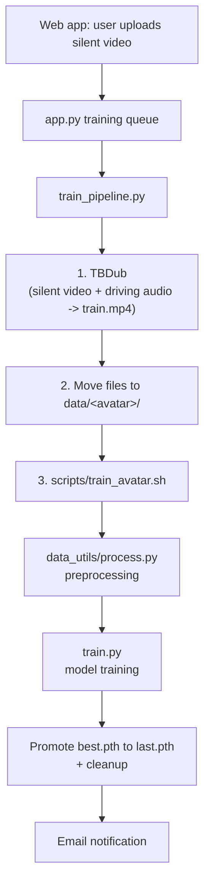

# FeatherTalk Training Pipeline

This document gives a high-level overview of how a new avatar is trained in FeatherTalk. The entry point is `train_pipeline.py`, which chains together all the individual steps and sends an email when it finishes.

## Overview



## Entry point: `train_pipeline.py`

```bash
python train_pipeline.py --avatar <name> --video <path/to/silent.mp4> --email <you@example.com> [--app-url <url>]
```

| Argument    | Description                                                        |
|-------------|--------------------------------------------------------------------|
| `--avatar`  | Avatar name (used for `data/<name>/` and `checkpoints/<name>/`)    |
| `--video`   | Path to the silent training video of the person                    |
| `--email`   | Address that receives the success/failure notification             |
| `--app-url` | URL used for the "Open FeatherTalk" button in the email (optional) |

In normal use you don't call it by hand. `app.py` runs a background worker that takes uploaded training jobs from a queue and starts `train_pipeline.py` for them **one at a time**.

### What the pipeline does

1. **TBDub** – Runs `/opt/digital-human/TBDub/scripts/tbdub.sh` on the uploaded silent video together with a fixed driving audio (`/opt/digital-human/TBDub/data/driving_audio.wav`). It runs in its own conda environment (default `tbdub`). The result is `uploads/<avatar>_tbdub_out.mp4`: a video where the person talks (with mouth movement), which is what the model needs for supervised training.
2. **Move files** – Creates `data/<avatar>/` and moves:
   - TBDub output -> `data/<avatar>/train.mp4`
   - original silent video -> `data/<avatar>/silence.mp4` (used later as the idle/silence video)
3. **Train** – Runs `scripts/train_avatar.sh <avatar>` (see below).
4. **Notify** – Sends an HTML email (success or failure with the error text) through SMTP. If SMTP is not configured, this step is skipped.

The complete log is written to `uploads/<avatar>_train.log`. If any step fails, the pipeline logs the error, removes the temporary TBDub output, sends the failure email and exits with code 1.

### Configuration

Values are read from environment variables or from a `.env` file in the repo root (existing environment variables take precedence):

| Variable          | Default                       | Purpose                                     |
|-------------------|-------------------------------|---------------------------------------------|
| `CONDA_BASE`      | `/home/ultimate/miniconda3`   | Conda installation used to locate TBDub env |
| `TBDUB_CONDA_ENV` | `tbdub`                       | Conda env in which TBDub runs               |
| `APP_URL`         | `--app-url` value             | Link in the notification email              |
| `SMTP_SERVER`     | –                             | SMTP host (required for email)              |
| `SMTP_PORT`       | `587`                         | Port (`465` = SSL, otherwise STARTTLS)      |
| `SMTP_SENDER`     | –                             | "From" address and SMTP login               |
| `SMTP_PWD`        | –                             | SMTP password                               |

## Training script: `scripts/train_avatar.sh`

Takes the avatar name and expects `data/<avatar>/train.mp4` to exist. It runs four steps:

1. **Preprocess** – `data_utils/process.py` (details below).
2. **Create output directories** – `checkpoints/<avatar>/` and `outputs/train_preview/`.
3. **Train** – `train.py` with `--asr hubert --unet original --epochs 200 --batchsize 16 --save_every 5`. With `--see_res` it also writes a sample prediction image every epoch into `outputs/train_preview/` so progress can be checked visually.
4. **Finalize checkpoint** – Copies `best.pth` (the checkpoint with the lowest training loss) to `last.pth` and deletes all other `.pth` files. The final model used for inference is `checkpoints/<avatar>/last.pth`.

### `data_utils/process.py` (preprocessing)

Prepares everything the trainer needs from `data/<avatar>/train.mp4`:

1. **Extract audio** – `ffmpeg` -> `aud.wav` (16 kHz).
2. **Extract frames** – every frame saved as `full_body_img/<n>.jpg`. The video must be exactly **25 fps** for HuBERT.
3. **Detect landmarks** – face landmarks per frame saved into `landmarks/<n>.lms`.
4. **Extract audio features** – runs `feather_hubert/feather_hubert.py` with the checkpoint `assets/featherhubert/feather_hubert_188_latest_99.pth` and stores features in `aud_hu.npy`.

### `train.py` (model training)

Trains the lip-sync UNet that maps audio features + a masked face frame to the full face image. It trains for the given number of epochs, saves `<epoch>.pth` every `--save_every` epochs, keeps `last.pth` (latest epoch) and `best.pth` (lowest loss), and can resume from a checkpoint via `--resume`.

## Resulting directory layout

```
data/<avatar>/
  silence.mp4          # original silent video
  train.mp4            # TBDub output used for training
  aud.wav              # extracted audio
  aud_hu.npy           # audio features
  full_body_img/       # extracted frames
  landmarks/           # per-frame landmarks
checkpoints/<avatar>/
  last.pth             # final model (copy of best.pth)
uploads/
  <avatar>_train.log   # full pipeline log
outputs/train_preview/ # sample predictions during training
```

## Other related scripts

These are **not** called by `train_pipeline.py`, but belong to the training workflow:

- `scripts/train_avatar_temporal.sh <avatar>` – Alternative manual training script. Uses `train_mouth_roi_temporal_loss.py`, which adds extra loss terms (mouth-region weighting, adjacent-frame temporal consistency, small perceptual loss). It also validates that the number of audio feature frames matches the number of video frames before training, and keeps intermediate checkpoints by default so different epochs can be compared. Hyperparameters can be overridden through environment variables (`EPOCHS`, `BATCH_SIZE`, `MOUTH_WEIGHT`, `TEMPORAL_WEIGHT`, `KEEP_ONLY_LAST`, ...).
- `scripts/prepare_idle_cache.py <avatar>` – Optional step after training. Pre-generates the shared idle media for an avatar so the first user doesn't have to wait for it, e.g. `docker compose exec feathertalk python scripts/prepare_idle_cache.py <avatar>`.
